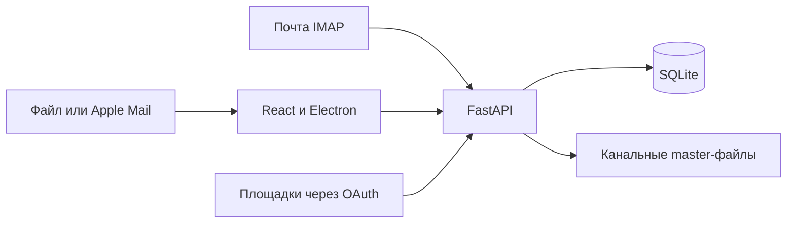
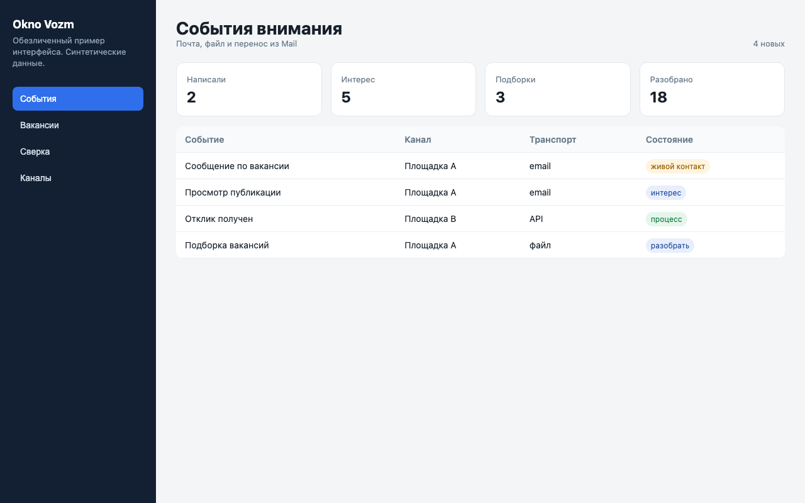
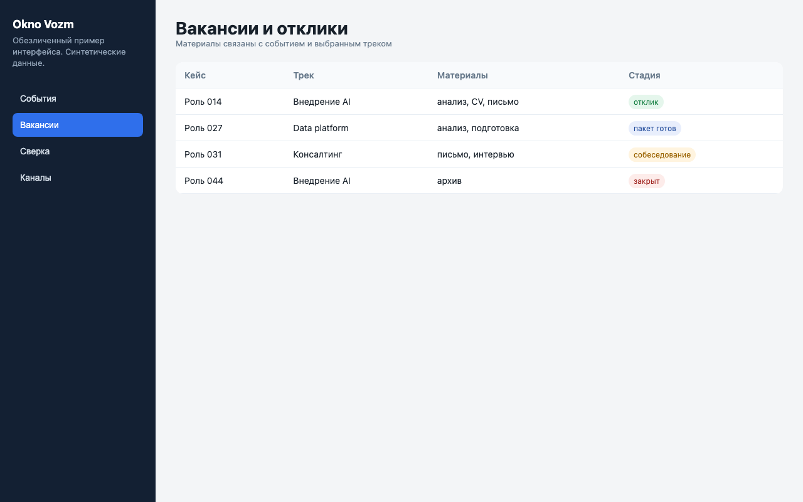
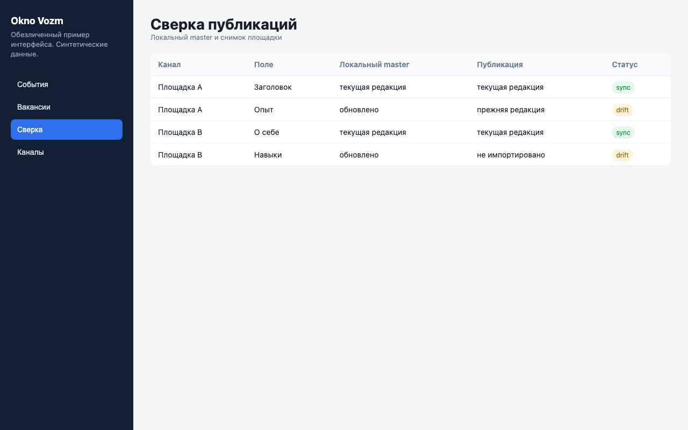
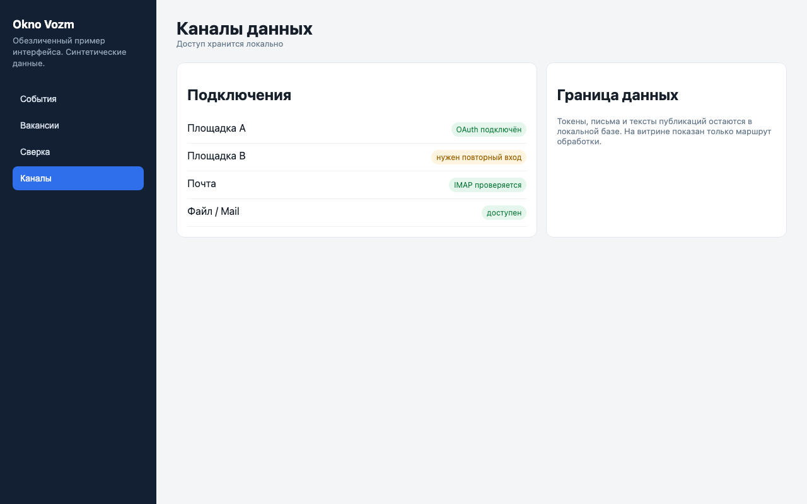

# Okno Vozm

Публичная витрина личного рабочего контура. Production-код, письма, резюме, токены и материалы откликов остаются в приватном репозитории. Здесь показаны задача, архитектура, границы и обезличенные экраны.

**Статус:** живой личный контур, используется в текущей работе.  
**Последнее содержательное обновление:** 22 ноября 2026.  
**Роль:** постановка, архитектура, реализация, проверка и ежедневное использование. Контур авторский.

## Задача

Когда несколько версий профессионального профиля живут в локальных файлах и на внешних площадках, ручная сверка быстро расходится с фактическими публикациями. Okno Vozm собирает этот цикл в одном локальном приложении:

- входящее внимание и сообщения;
- связь события с вакансией и подготовленным пакетом материалов;
- канальные версии профиля;
- сверка локального master со снимком публикации;
- подключение площадок и почты.

## Архитектура

Поток данных:

1. Событие попадает из письма, файла или переноса выбранного письма из Apple Mail.
2. Backend классифицирует источник, тему и тип события.
3. Событие сохраняется в SQLite и сопоставляется с треками и канальными версиями.
4. Экран сверки сравнивает локальный master со снимком публикации и помечает совпадение либо расхождение.
5. Карточка вакансии открывает связанные материалы: анализ, версию профиля, письмо и подготовку к разговору.

Electron нужен для случая, когда почтовая программа отдаёт системный объект переноса, а браузер не получает файл. Если файл доступен, интерфейс обрабатывает его напрямую.

## Стек и выбор

| Слой | Технология | Зачем |
|---|---|---|
| Интерфейс | React, Vite | Рабочие экраны и сверка |
| Desktop-мост | Electron | Перенос письма из Apple Mail |
| API | Python, FastAPI, Pydantic | Импорт, OAuth, классификация, выдача данных |
| Данные приложения | SQLite | Локальные события, подключения и токены |
| Версии профиля | Markdown и JSON-файлы | Проверяемый источник формулировок |
| Запуск | Docker Compose | Backend и frontend одним контуром |

SQLite выбрана потому, что контур личный и локальный: одна база проще переносится и резервируется вместе с рабочими файлами. Файлы master остаются читаемыми вне приложения, поэтому правку версии можно проверить до публикации.

## Сервисы и интеграции

- Backend читает канальные master-файлы и подготовленные пакеты материалов.
- OAuth используется для подключения площадок и получения снимков публикаций. Если API площадки ограничивает доступ, остаётся импорт HTML, PDF или текста.
- IMAP забирает заголовки и письма по локально сохранённым настройкам и фильтрам.
- Пароли и токены хранятся в локальной базе и файле окружения, в публичную витрину не входят.

Основные группы API: события и импорт, вакансии и пакеты материалов, каналы и OAuth, почтовый транспорт, сверка публикаций, проверка состояния.

## Данные и изменения схемы

Схема SQLite создаётся и дополняется при запуске backend. Основные записи: события, вакансии, подключения каналов, состояния OAuth, токены, настройки и фильтры почты, журнал загрузки писем.

Изменение схемы применяется в том же приложении, которое работает с данными. Отдельной внешней системы миграций нет: для локального однопользовательского контура это сохраняет схему рядом с кодом.

Операции записи, которые должны сохраниться целиком, проходят через транзакцию SQLite. Файл базы и рабочий каталог образуют границу восстановления. Публичная витрина не описывает расписание резервного копирования.

## Проверка

Автоматические проверки закрывают классификацию писем: тип события определяется по теме, отправителю и тексту. Это защищает разбор входящих от смешения живого контакта, интереса, подборки и служебного уведомления.

Отдельного сквозного UI-regression и обязательного CI-gate в публичной витрине нет. Рабочая проверка включает запуск Docker Compose, импорт контрольного письма и сверку экрана со снимком публикации.

## Размещение

Приложение рассчитано на локальный запуск:

- `docker compose up` поднимает FastAPI и React;
- SQLite хранится в локальном volume;
- Electron запускается отдельно и обращается к backend;
- внешние адреса, секреты и параметры OAuth задаются локальным окружением.

Это личный рабочий инструмент, а не многопользовательский сервис.

## Экраны

Синтетические данные, без писем, публикаций и контактов.

## Ограничения и следующий шаг

- Контур остаётся локальным и однопользовательским.
- Сопоставление события с треком в текущей версии основано на правилах и пересечении признаков. Семантическая модель может заменить этот слой позже.
- Доступ площадок зависит от их API: при закрытом методе используется файл или ручной снимок.
- Следующий практический шаг — расширить автоматические проверки с классификации писем на импорт и сверку снимков.

## Граница публикации

Публичная страница показывает устройство и состояние системы. Исходный код, история рабочей разработки, данные и секреты остаются приватными.
